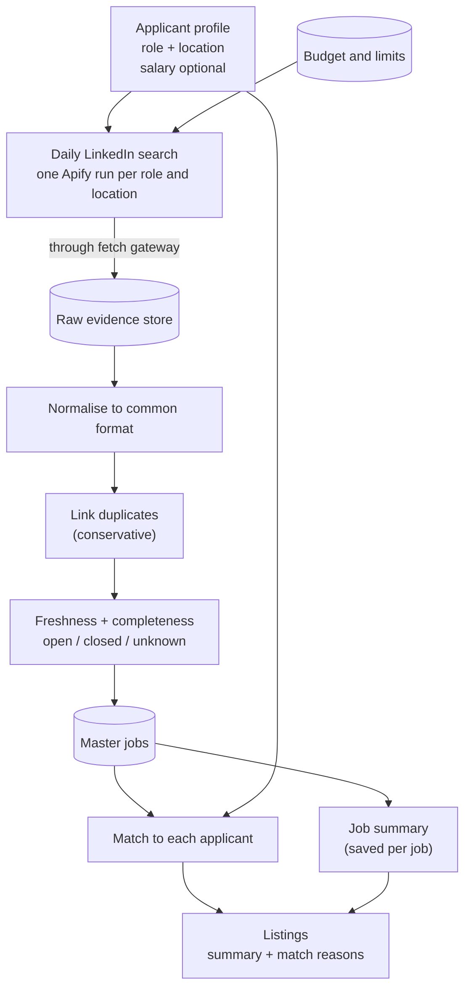

# MVP — Job Discovery with Data Quality

> **Current job sources (15 November 2026, decision D54).** Job listings come from LinkedIn and Indeed, scraped once a day through Apify (`blackfalcondata/linkedin-job-scraper` and `valig/indeed-jobs-scraper`). The worker will not search without `APIFY_API_TOKEN`, and each run is reserved against the monthly money cap in `budget_policy`. How that works is in the README, `app/linkedin.py` and `app/indeed.py`. Direct fetches of linkedin.com / indeed.com stay blocked. D54, at the end of section 20, is the note that replaced the earlier sources.

> **MVP only. Standalone plan.** This file doesn't depend on any other file. Anything not described here is outside the MVP. Section and test numbers are kept stable, so some numbers are skipped.

## Contents
1. [Starting point](#1-starting-point)
2. [Goal](#2-goal)
3. [User flow](#3-user-flow)
4. [Scope](#4-scope)
5. [Sources](#5-sources)
6. [The pipeline at a glance](#6-the-pipeline-at-a-glance)
7. [Stages: inputs and outputs](#7-stages-inputs-and-outputs)
10. [AI, code and people: who does what](#10-ai-code-and-people-who-does-what)
11. [Request and cost limits](#11-request-and-cost-limits)
12. [Safe public fetching](#12-safe-public-fetching)
13. [Failure handling](#13-failure-handling)
14. [Data quality and matching](#14-data-quality-and-matching)
15. [Database entities](#15-database-entities)
16. [Quality report](#16-quality-report-admin-only)
17. [Acceptance tests](#17-acceptance-tests)
18. [MVP milestones](#18-mvp-milestones)
19. [Build order](#19-build-order)
20. [Decisions, assumptions and things to validate](#20-decisions-assumptions-and-things-to-validate)
21. [Open questions](#21-open-questions)
22. [Privacy](#22-privacy)

---

## 1. Starting point
- **The project starts from an empty folder;** step 0 of the build order (section 19) sets it up.
- **This file is the whole plan.** No other plan files are needed.

## 2. Goal
Give each user the highest-quality job listings for the roles they target, with a short summary and an explained match score. Clean, good data comes first because every other feature depends on it.

**Quality over volume:** grow the number of jobs only while the quality report stays on target.

## 3. User flow
1. **Register and log in** (Milestone 2). Applicants can also be created through a simple admin form.
2. **Profile:** target role(s), location(s), optional expected salary, skills, certifications and licences, experience level, travel distance, and a CV upload (stored; read by AI only when the person asks, to fill the form, D43).
3. **Behind the scenes:** once a day the worker searches LinkedIn and Indeed through Apify for each target role and location, and stores the jobs it finds (D54).
4. **Listings:** open, real, complete, de-duplicated jobs matched to the applicant, each with a summary and a match score showing what matched and what's missing.

## 4. Scope
- **UK tech roles only.**
- Every job and search carries a sector tag, and sectors are set in configuration, not code. The MVP builds only the tech sector, but this tag keeps it sector-ready.

## 5. Sources

Job listings come from LinkedIn and Indeed, scraped once a day through Apify. Decision D54 (updated 15 November 2026) replaced the earlier source list. The worker and the tests are `app/linkedin.py`, `app/indeed.py`, `tests/test_linkedin.py` and `tests/test_indeed.py`.

| Source | Used for | When |
|---|---|---|
| LinkedIn, via Black Falcon Data on Apify | Entry-level jobs for each target role and location | Once a day, within the monthly money cap |
| Indeed, via `valig/indeed-jobs-scraper` on Apify | Graduate / junior / entry-level title × location (UK site); D46 filters entry evidence | Once a day after LinkedIn, within the same money cap |

Set `APIFY_API_TOKEN` (the Apify API token). Without it, nothing is searched. Each search is one Apify run. It is reserved against the monthly money cap in `budget_policy` before it starts, and the recorded cost is what Apify reports.

---

## 6. The pipeline at a glance



**In plain terms:**
1. An applicant says what job they want and where.
2. Once a day the worker searches LinkedIn through Apify for each target role and location, within the budget.
3. Every response is kept as evidence.
4. Jobs are cleaned, de-duplicated, given a freshness state and matched to each applicant.
5. A short summary is written for each matched job.

---

## 7. Stages: inputs and outputs
| # | Stage | Input | Output | Who |
|---|---|---|---|---|
| 0 | Applicant profile | Account and profile details (roles, locations, optional salary, and the rest of the profile) | Saved applicant and profile | Code (form) |
| 8 | Collection | Each person's target roles and locations | Fetch runs, raw responses, job postings | Code, through the fetch gateway |
| 9 | Cleaning | Job postings | Master jobs with provenance, linked duplicates, freshness, completeness, salary status | Code |
| 10 | Matching | Master jobs; each applicant's profile | Matches with reasons | Code |
| 12 | Summaries | A matched job, or one opened for the first time | One saved summary per job | AI drafts; code checks and saves |
| 13 | Listings | An applicant's matches | Listings page: open jobs sorted by match score | Code |

### Stage 0: Applicant profile
- Expected salary is stored as a **matching preference only**. It's never sent to the search or AI, and it never affects spending (section 11).
- No salary given → no salary filter.

### Stage 8: Collection
Once a day the worker runs one LinkedIn search per target role and location (D54). Every run is stored as a fetch run with its raw payload.

### Stage 9: Cleaning
1. Convert every posting to the common job format (below), keeping a link to its raw response.
2. **Link duplicates conservatively:** reposts link by company, cleaned title, city, date and advert text. Uncertain pairs stay separate.
3. **Freshness:** a job closes when no search has found it for 14 days, and opens again when one does (D54).
4. **Completeness:** per field and per source.
5. **Salary:** stored as known or **unknown**. Missing salary is never treated as zero.

**Job format:** title, company, employer type (direct/agency), location (city, country, remote type), pay (normalised to a common period, or unknown), hours, contract type, required licences, posted date, closing date, first seen, last seen, full description, apply link, source, sector, and a link to the raw response.

### Stage 10: Matching
- Happens **after** collection: each job is collected once, then matched to every relevant applicant.
- Rules are in section 14.

### Stage 12: Summaries
- Generated for matched jobs ahead of time, or the first time any user opens a job, then saved and reused for everyone.
- Uses only the posting's text. Code rejects a summary containing a number, date or name that isn't in the posting, and the job shows its description instead.
- Counts toward the AI caps (section 11). If the budget is used up, listings show the description without a summary.

### Stage 13: Listings
- Shows **open** jobs only. Jobs in the `unknown` state stay hidden until they're confirmed open again.
- Each listing shows: title, employer, location, salary (or "not stated"), summary, match score with reasons, when it was last confirmed open, source, and apply link.
- Sorted by match score.

---

## 10. AI, code and people: who does what
| Task | AI | Code | People |
|---|---|---|---|
| Choose searches and spend money | — | Budget gate | Set budgets |
| Call APIs | — | Fetch gateway | — |
| Remove duplicates, track freshness, match jobs | — | All of it | — |
| Write job summaries | Drafts from the posting text only | Checks it against the posting, saves one per job, enforces AI caps | — |
| Judge and report on each job's fit | Scores from the advert and the profile | Checks every name and number against the texts, applies the caps | — |
| Read a CV to fill the profile | Suggests, when the person asks | Drops anything not in the CV | Press Save |

**AI guardrails:**
1. **Read-only input.** AI only reads the posting or profile it's given. It has no tools, can't browse, and can't write to the database.
2. **Page content is data, not instructions.** Retrieved content is wrapped and labelled as data, and instructions inside it are ignored. Code also scans for common injection phrases and skips those adverts.
3. **Results are cached by input,** with the model and prompt version recorded. The same input is never paid for twice, and every decision can be audited.
4. **Only where needed, within caps.** AI runs within per-item and per-day token caps and the monthly money cap.

---

## 11. Request and cost limits
**Two different things that are never mixed:**
- **Expected salary:** an applicant's preference, used only when matching jobs. Optional. Never sent to the search or AI.
- **Spending limit:** a system setting that caps scraping and AI costs. It has nothing to do with any applicant's salary.

| Limit | Default | Notes |
|---|---|---|
| Monthly budget (scraping + AI) | **Not set (B1)** | Must be set before paid calls run |
| AI | Per-item and per-day token caps (summaries, judging, reports) | Set once AI cost is known (B4) |
| Provider quotas | From each provider's docs | Enforced in the fetch gateway |

**The budget gate:**
1. Estimates the cost before every paid call, and refuses calls that would go over the cap.
2. Records the actual cost afterwards.
3. Warns at 80% of the cap.
4. Refused work waits. Nothing is marked failed because of budget.

**If the budget is £0:** nothing paid runs. Searches and summaries stop, while cleaning, matching and the listings page keep working on the jobs already stored.

---

## 12. Safe public fetching
Every outside request goes through **one fetch gateway**, so these rules are enforced in one place.

**What we fetch:**
1. Public API endpoints on an allowlist: Apify and the AI provider.
2. **Blocked outright:** LinkedIn, Indeed and Glassdoor pages. LinkedIn is read only through Apify.

**How politely:**
3. Check robots.txt before fetching any web page, cache it for 24 hours, and respect it.
4. Name the crawler in the User-Agent, with a link to the project (e.g. the GitHub repo).
5. One request at a time per host, at most one per second. Honour `Retry-After` and back off on errors.
6. Timeouts, a size limit, HTML and JSON only, at most 3 redirects.

**What we never do:**
7. Log in, use a personal account's cookies, solve CAPTCHAs, rotate proxies or IP addresses, or disguise the crawler.
8. Run JavaScript or a headless browser.

**Security:**
9. **HTTPS only.** Refuse IP-address URLs and any address that resolves to a private, local or internal network, and re-check after every redirect. This stops a malicious page, or a bad AI suggestion, from making your server call internal systems.
10. **Treat all fetched content as untrusted:** never run it, clean it before showing it, and never follow instructions in it.
11. **Store only what's needed.** For job APIs: the raw response, subject to each source's terms.

---

## 13. Failure handling
| Situation | What happens | What never happens |
|---|---|---|
| Apify run fails or times out | The run is marked failed and the search is tried again at the next daily run | Treated as "no jobs found" |
| A run or fetch fails or is partial | Nothing is closed because of it (D8) | Jobs closed |
| A job isn't found by any search | It closes only after 14 days without a search finding it (D54) | Closed because one search missed it |
| A summary fails its check | Rejected; the job shows its description instead | An unchecked summary shown |
| Budget used up | Searches and AI work pause; cleaning, matching and listings continue | Work marked failed |
| Crash or re-run | Unique keys prevent duplicates; work resumes | Duplicate records |

---

## 14. Data quality and matching
**Data quality checker (per job, same for every user):**
| Measure | Rule |
|---|---|
| **Recent** | Still listed at its source in the last 48 hours and before its closing date. Listings older than 60 days are flagged, not removed (grad schemes stay open for months). |
| **Real** | High/medium/low confidence with reasons. LinkedIn jobs rate medium. Other signals: company found in Companies House, apply link on the company's domain, repost count, scam signs (payment requests, chat-only contact), which keep a job off the page. |
| **Complete** | Title, location, apply link and full description (not a snippet). Employer name and salary tracked but optional. |
| **Unique** | Under 2% duplicates. The same advert in a different city is not a duplicate (D34). |

**Relevance (per user, reported separately):** how well a job's title and skills match the user's target roles and skills. It's measured in the match score and reported separately from the four quality measures, so bad matching can be told apart from bad data.

**Match score (rule-based):**
- Role/title match, location fit, salary status (meets / below / unknown; unknown is never excluded).
- Skill overlap using the ESCO skills taxonomy (so synonyms like "Postgres" and "PostgreSQL" match), and required certifications or licences met or missing.
- Always shows what matched and what's missing alongside the number.

---

## 15. Database entities
Purposes and key fields only. The exact schema lives in the models and migrations.

**Applicants and profiles**
| Entity | Purpose | Key fields |
|---|---|---|
| `applicant` | A person using the app | email, password hash, session version, created_at |
| `applicant_preference` | What they're looking for | target roles, locations, sector, expected salary (optional: amount, currency, period) |
| `applicant_profile` | Extra profile details | experience level, travel distance |
| `applicant_skill` | Skills they have | applicant, skill (taxonomy entry, if any), text as typed |
| `applicant_certification` | Certifications and licences | applicant, name, issuer, is a licence?, expiry date (optional) |
| `cv_file` | Uploaded CV, stored; read only to suggest profile entries when its owner asks (D43) | applicant, file contents (D38), file type, size, uploaded_at |

**Spending**
| Entity | Purpose | Key fields |
|---|---|---|
| `budget_policy` | Caps | provider, period, money cap, request cap |
| `spend_ledger` | Every paid call | provider, related run or item, estimated cost, actual cost, units, time |

**Collection and jobs**
| Entity | Purpose | Key fields |
|---|---|---|
| `fetch_run` | One collection request | source, search, outcome, status codes, jobs returned, requests, times |
| `raw_payload` | Original response | fetch run, source job ID, payload, hash, fetched_at |
| `job_posting` | One copy of a job from one source | source + source job ID (unique), employer (blank for agencies), common-format fields, places (D34), salary (min, max, currency, period, known/unknown), first seen, last seen |
| `job` | Master record users see | merged fields including places, which source each field came from, freshness (open / closed / unknown), closure evidence, quality results |
| `job_link` | Why postings were linked | posting, job, method, confidence, reason |
| `job_summary` | One saved summary per job (D41) | job, status (pending / accepted / rejected), summary text, unsupported facts found by the check, posting hash, model, prompt version, tokens, cost, created_at |

**Skills taxonomy**
| Entity | Purpose | Key fields |
|---|---|---|
| `skill` | One taxonomy entry, from ESCO or our own list (D39) | taxonomy ID, source, preferred label, alternative labels, is technical, version |
| `skill_label` | Each name a skill goes by, in one searchable form | skill, label, normalized text, is preferred |
| `job_skill` | A skill found in a job | job, skill, matched text, how matched (exact / alternative label) |

**Matching**
| Entity | Purpose | Key fields |
|---|---|---|
| `applicant_job_match` | A job matched to an applicant | applicant, job, score, reasons, matched skills, missing skills, missing licences, salary status (meets / below / unknown) |

---

## 16. Quality report (admin only)
- **Jobs:** per source and per sector, the number of jobs, % meeting each measure, duplicate rate, % expired and last successful run.
- **Collection:** fetch outcomes by source; jobs by freshness state.
- **Summaries:** generated, rejected by checks, and AI cost.

---

## 17. Acceptance tests
Written as behaviours to prove. Each becomes one or more automated tests.

**Preferences and budget**
- **T1:** Expected salary is saved as a preference and never appears in search queries, AI inputs or budget calculations.
- **T2:** With no salary given, no job is excluded for salary.
- **T3:** No paid call runs if it would exceed the monthly cap. Refused work waits and isn't marked failed.
- **T4:** When the budget runs out, searches and AI work stop, while cleaning, matching and listings continue.

**Safe fetching**
- **T19:** Requests to private or local addresses, including through redirects, are refused.
- **T20:** Pages blocked by robots.txt aren't fetched, and LinkedIn, Indeed and Glassdoor are blocked.
- **T21:** No host receives more than one request per second.

**Collection and jobs**
- **T22:** Failed, partial and empty fetches never close jobs. Simulate timeouts, server errors, empty bodies and half-finished responses.
- **T23:** A job closes only after no search has found it for 14 days, and opens again when one does.
- **T25:** A repost with the same company, title, city, date and advert text links to the same job. Uncertain matches stay separate.
- **T26:** Every master job traces back to raw responses and fetch runs, and missing salary shows as unknown.

**Matching**
- **T27:** Each job is collected once and matched to every relevant applicant. No applicant triggers duplicate collection.

**Accounts, profile, summaries and listings (Milestone 2)**
- **T29:** Users can register, log in and log out. Passwords are stored only as secure hashes, and pages with personal data need a login.
- **T30:** The profile saves target roles, locations, optional salary, skills, certifications and licences, experience level and travel distance.
- **T31:** CV uploads accept only allowed file types and sizes, are stored privately (no public link), are read only when their owner uploads or asks (D43), and can be replaced or deleted.
- **T32:** Deleting an account removes the profile, CV, preferences and matches.
- **T33:** Profile skills and job skills map to the same taxonomy entries, so synonyms match (e.g. "Postgres" and "PostgreSQL").
- **T34:** Each match shows matched and missing skills, role match, location fit, salary status and missing required licences. Relevant is reported separately from the four quality measures.
- **T35:** A summary is created once per job and reused for every user. A summary containing a number, date or name that isn't in the posting is rejected.
- **T36:** Listings show open jobs only, sorted by match score, each with its source and apply link.
- **T37:** If the AI budget is used up, listings still work and show the job description instead of a summary.

---

## 18. MVP milestones
### Milestone 2: accounts, profile and listings (MVP complete)
**In:** register/login; the full profile with CV upload; ESCO skills mapping for profiles and jobs; the match score with skills and licences; summaries; the listings page.

**Done when (the MVP is complete):**
1. T29–T37 pass, and T1–T4, T19–T23 and T25–T27 still pass.
2. A new user can register, fill in their profile, upload a CV, and see UK tech jobs that are open, real, complete and free of duplicates, each with a summary and an explained match score.
3. The quality report shows 95%+ complete, no expired jobs shown, and under 2% duplicates.
4. A manual check of 30 jobs against their original postings finds no wrong locations, cut-off descriptions or closed jobs.

---

## 19. Build order
Each step is small. Run the code and its tests before starting the next one.

**Stage 0: Setup**

0. **Project setup:** an empty repository, language and web framework, database, migrations, test runner, settings from environment variables, and the folder layout. Compare options first; D22 has the proposed defaults. *Why first:* every later step needs a running app with tests.

**Stage A: Foundations**
1. **Data model** for the entities in section 15. *Why first:* every stage reads and writes these tables, and getting the unique keys right now prevents duplicates later.
2. **Fetch gateway, budget gate and spend ledger.** *Why:* every outside request goes through one door, so safety and spending rules are enforced once, not in every feature.

**Stage B: Applicants**

4. **Admin form for applicants** (roles, locations, optional salary).

**Stage C: Jobs**

12. **Common format,** duplicate linking, freshness, completeness and salary status.
13. **Quality checker and admin quality report.** *Gate:* stop here until the quality targets are met.

**Stage D: Matching**

14. **Match jobs** to each applicant (role, location, salary status).

**Stage E: Accounts, profile and listings (Milestone 2)**

17. **Register/login,** with secure password hashing. Existing admin-created applicants move to real accounts.
18. **Profile intake:** roles, locations, salary, skills, certifications and licences, experience level, travel distance, CV upload (stored privately, read to fill the form when the person asks, D43), and account deletion.
19. **Skills taxonomy (ESCO)** mapping for profiles and jobs, with autocomplete in the profile form.
20. **Match score with reasons,** adding skills and licences.
21. **Job summaries:** checked against the posting and saved per job.
22. **Listings page:** open jobs sorted by match score, with summary, reasons, source and apply link. *Final gate:* the MVP's "done when" in section 18.

**Kickoff prompt (Plan mode):**
```
Read MVP.md. It's the whole plan, and we're starting from an empty folder. We're on step 0 of section 19. Compare options for: language and web framework, database, migrations, test setup, settings and folder layout, using D22 as the starting proposal. Then, for Stage A, compare options for the data model in section 15 (including unique keys), the fetch gateway (allowlists, robots.txt, per-host rate limits, private-network blocking, timeouts) and the budget gate. Recommend. No code yet.
```

---

## 20. Decisions, assumptions and things to validate

### Decisions (made in this plan; change any you disagree with)
| ID | Decision |
|---|---|
| D3 | Expected salary is a matching preference only; spending limits are system settings; neither ever reads the other. |
| D4 | Missing salary = unknown. Never zero, never excluded by default. |
| D8 | Failed requests never close jobs. |
| D14 | No headless browser in the MVP. |
| D15 | For job APIs, store raw responses (subject to terms); for web pages, store only evidence snippets and URLs. |
| D17 | Daily collection; one master record per employer posting (covering all its locations); a repost with a new ID counts as the same job if company, title and description match within 30 days and it shares a place (D34). |
| D19 | Not used: Bing (retired), Google Custom Search (closed to new customers), Google-scraping services, JobSpy, and direct scraping of LinkedIn, Indeed or Glassdoor pages. LinkedIn and Indeed are read only through Apify (D54), never fetched directly. |
| D20 | Applicants were first created through an admin form; accounts and the full profile came in Milestone 2. |
| D22 | Confirmed in step 0: Python 3.12+, FastAPI, SQLAlchemy 2.x, PostgreSQL 16 via Docker Compose (database-backed queue with row locking, JSONB for raw responses), Alembic migrations, uv + pyproject.toml, pydantic-settings from .env, pytest + httpx + pytest-asyncio. One worker process (app process first; worker loop in later steps). Folder layout: app/{main.py,core,api}, alembic/, tests/, docker-compose.yml. |
| D23 | Listings show open jobs only; `unknown` jobs stay hidden until confirmed open. |
| D24 | Summaries are generated on first view, once per job, from the posting text only, and checked before they're shown. |
| D25 | CVs are stored privately; PDF or DOCX only, up to 5 MB (defaults). Originally not parsed; D43 adds reading on the person's request. |
| D26 | Authentication uses a standard, well-tested library for password hashing and sessions; no custom security code. |
| D28 | Fetch gateway and budget gate follow `docs/step2-fetch-budget-design.md`: outbound HTTP via `httpx` with manual redirects; stdlib robots.txt parser with 24h in-process cache for page fetches only; in-process per-host 1 req/s limit; HTTPS + DNS/private-address checks on every hop; LinkedIn/Indeed/Glassdoor blocked; paid calls insert `spend_ledger` with estimate before the call and settle after; missing/null/zero monthly `money_cap` refuses paid calls until B1. |
| D32 | Cleaning details the plan left open, set in Step 12. **Strong match:** same employer, cleaned title and city, with posted dates within 14 days, and exactly one possible master job. Two listings from the same source also need identical advert text, because they may be separate openings. A missing employer, city or date keeps the pair separate. **City:** recorded only when the location names one place. Multi-city locations keep only the country and remote type in the single columns, and D34 adds the list of places, which location matching must use. **Salary:** taken only from structured fields. Monthly and weekly pay are multiplied up to yearly; hourly and daily pay stay as stated, because converting them needs assumed hours. |
| D42 | Listings page, set in Step 22 (2026-11-09). **Where:** `/listings`, for logged-in people, 25 a page, linked from `/account`. **What:** the person's stored matches whose job is open now, best score first. By default only jobs that fit their locations show, with a link to include the rest, because matching keeps wrong-place jobs at a lower score (D35). Each shows title, employer, places, salary or "Not stated", score, role, location, salary status, skills held and missing, missing licences, last confirmed open, source and apply link. Only http(s) apply links are rendered. **Summaries:** the listing never calls the AI. It shows a job's accepted summary if one exists, otherwise the full description in a folded section (T37). Opening the job at `/jobs/{id}` writes the summary (D41). **Matching on save:** saving a profile matches that person at once, so a new user sees jobs without waiting for the next collection. |
| D43 | CV reading to fill the profile, set on 2026-11-10 (operator decision). **When:** only when a person uploads a CV, or presses "Fill my profile from my CV" on their profile page. Nothing reads a CV in the background. **How:** the text is taken out of the file in memory: PDFs with `pypdf`, first 10 pages; Word files from `word/document.xml` with a regular expression, not an XML parser, so D38's "nothing is parsed as XML" still holds. At most 24,000 characters go to Claude (the provider default model) as untrusted data, through the fetch gateway, with a JSON schema for target roles, locations, experience level, skills and certifications. **Checks:** every skill, location, certification and issuer must appear in the CV text, or it is dropped. Target roles may be inferred, up to 3, because a CV rarely names the next job. **Form:** suggestions only fill empty fields and add skills and certifications the person doesn't have. They are never stored. Nothing is saved until the person presses Save. **Cost:** each read reserves £0.005 through the budget gate as `ai_cv_read` (migration `0011`); with no money left, the CV isn't sent. Uploads and fill presses share the 20-per-hour limit. **Privacy:** this replaces the earlier rule that CV text never leaves the machine. The privacy notice says CV text goes to Anthropic at those two moments. |
| D44 | Discovering jobs by skills, set on 2026-11-10 (operator request: show people roles they may not know they qualify for). **Rule:** a job whose title fits none of the target roles still matches when the applicant holds at least 3 of the skills its advert names and at least half of them. Its role kind is `skills`, worth 0.2 against 0.3 for a similar title and 0.5 for an exact one, so it never outranks a target-role match with the same fit. Every other rule still applies: location, salary, licences, internships only for internship seekers, no training roles, and for entry seekers no senior titles and no years-of-experience adverts unless the title says entry level. `role_match` stays false for these rows. **Where:** the listings page shows target-role matches by default. A "Show" filter switches to "Roles my skills fit" or both, each skills match carries a "Fits your skills" tag and says how many of the advert's skills the person has, and a banner over the default view counts the skills matches with a link to them. Someone with no saved skills is told to add them or read them from their CV. |
| D45 | Degree subjects, set on 2026-11-10 (operator request: a Business Management graduate shouldn't see jobs that require a Computer Science or STEM degree). **Profile:** an optional "Degrees" list on `applicant_profile.degrees`, up to 5, as typed, such as "BSc Business Management". A degree being studied for counts. Reading a CV suggests degrees too, kept only when every word of the degree is in the CV. **Advert rule:** `app/matching/degrees.py` finds each degree mention (degree, bachelor's, master's, BSc, MSc, PhD and similar) and reads the subjects from the three words before it and the text after it, up to the next requirement. Subjects map to fields: computing, maths, science, engineering, economics, business, law, design and psychology. "STEM" means the first four, and "quantitative" means those plus economics. The requirement is optional, and hides nothing, when nearby wording says "or equivalent", "preferably", "a compelling narrative about your alternative path", "Level 3 qualification or", "we do not ask for", and similar. Experience offered after the degree always keeps the job: "or 3 years of relevant experience", "or demonstrable experience", "in lieu of a degree", "or a portfolio" (operator request). Only an explicit degree mention counts: "strong technical skills" on its own is never a requirement. **Match rule:** a job is left out when any required degree names fields that none of the applicant's degrees covers. Someone who lists no degree is never shut out, and a subject the rules don't know never shuts anyone out. **Checked on 2026-11-10:** over 1,893 open jobs, 191 have a required subject and 144 are hidden for "BSc Business Management". The hidden list was read in full, and the wrong calls found (MS Office, "a high degree of", "no formal qualifications", a full stop the window ran past) were fixed before release. |
| D46 | Entry level means shown to be entry level, set on 2026-11-10 (operator request: with graduate or entry-level roles chosen, only graduate and entry-level roles appear). **Who:** anyone whose profile level is "Entry level", or whose target role says graduate, junior or entry level. This applies to target-role matches, and skills matches (D44). **Rule:** a job counts only with evidence. Either its title says graduate, grad, junior, entry level or early careers, or its advert says entry-level, recent or new graduates, graduate scheme or programme, early careers, no experience required, or 0 to 2 years, and doesn't ask for 3 or more years. "Not an entry-level role" doesn't count. Senior, lead, manager and similar titles stay out. A job with no stated level, which earlier rules showed as "level not stated", is no longer shown. Advert evidence scores the same 0.1 as title evidence. **Checked on 2026-11-10:** for the operator's target roles, 269 open jobs fit the title. 23 show entry level in the title, 5 in the advert (all five read and genuine), and 241 are no longer shown. |
| D47 | Summaries written ahead of time, set on 2026-11-10 (operator request: the listings should show a summary, not the advert). Before, a summary was written only when someone opened a job's own page, so on 2026-11-10 only 1 of the 276 jobs in anyone's matches had one. **Rule:** `summarise_matches` in `app/summaries/generate.py` writes the summary for every open job in someone's matches that has none yet, best match score first, through the same `summary_for_view` path. So the fact check (D41), the budget gate, the per-item token cap and the daily token cap all still apply. It stops at the money cap or the daily token cap, and the next run carries on. A job nobody matches is never summarised. **When:** every worker cycle, and on demand with `python -m app.summaries`. A job opened before its turn still gets its summary on first view, as before. **Cost:** £0.001 a summary at the configured price, so the 276-job backfill is about £0.28 against the £2 monthly cap. **Check loosened, same day:** the first backfill rejected 49 of 129 drafts, mostly for ordinary words: "Key skills…", "Required:", "London-based", "API" for "APIs", "three days" for "3 days". The check (D41) now accepts sentence openers like these, compounds whose parts are in the posting or end in -based, -level and similar, singular and plural forms, and a number in words when the posting has the same number in digits before the same word. Invented names, numbers and dates are still rejected. Re-checking the stored drafts at no cost accepted 44. The 5 still rejected name things the posting writes differently ("CI/CD", "FX", "UK", "Taiwan", "two"). **Known names, same day:** the check now also accepts a name the posting writes another way, from a fixed list of pairs ("UK" for "United Kingdom", "CI" for "continuous integration", "MongoDB" for "Mongo"), and the parts of a hyphenated posting word ("English" from "English-language"). Capitals-only forms match only in capitals, so "us" never supports "US". Re-checked on the real database: 271 of 276 accepted; the 5 left name a place or number the posting does not. |
| D48 | Search box on the listings page, set on 2026-11-10 (operator request) | Typing words such as "python backend fintech" orders the person's matches by closeness in meaning, not by shared words. It never adds or hides a job: the filters still decide which jobs show. Each job gets a vector from its title and its checked summary, or the first 2,000 characters of its description, made on this machine with BAAI/bge-small-en-v1.5 (fastembed, now a main dependency), so a search costs nothing and sends nothing away. Vectors live in `job_embedding` (migration 0013) with a hash of their text, so a new summary or description gets a new one. The worker makes them after summaries each cycle; a search makes any still missing. Tried on the real matches: 276 jobs embedded in 40 s, then about 55 ms a search. |
| D50 | The AI judges every open job for each person, set on 2026-11-10 (operator request) | Claude Haiku reads each open job in the person's sector (title, employer, place, apply link, first 6,000 characters of the description) with their target roles, experience level, skills and degrees, and returns fits, the level the advert asks for, and a one-sentence reason. Verdicts live in `job_verdict` (migration 0014) and are reused until the job text or those profile fields change; location and salary stay code rules, so changing them costs nothing. Matching follows a current verdict over the rules: a fit is matched even when the rules miss it (role kind `ai`, scored 0.4, between exact and similar) and a no-fit is hidden even when the rules match it; unjudged jobs follow the rules. Degree and salary exclusions still apply. The page shows an "AI match" tag and the AI's reason, but only when every name and number in it is in the advert or the profile. The worker judges before summaries each cycle, jobs in the person's own locations first, newest first, within the money cap (recorded at £0.0003 a verdict, a ceiling from the Haiku prices in config) and `AI_JUDGE_DAILY_TOKEN_CAP` (4,000,000, about 1,000 verdicts a day; raised from 1,000,000 on the same day at the operator's request, which changes the speed, not the total cost). Calls go to the AI `AI_JUDGE_CONCURRENCY` (5) at a time; each is reserved against the caps before the batch is sent, and saved one at a time after. Adverts that look like instructions to the AI are skipped. The privacy notice now says roles, level, skills and degrees go to Anthropic with each advert. |
| D51 | The AI scores each job the way career-ops rates an offer, set on 2026-11-10 (operator request: use the metrics in career-ops' `modes/oferta.md` and `modes/_shared.md`, MIT licence) | The judge (D50) now rates four areas from 1 to 5: cv_match (skills, experience level and degrees against the advert, counting only what the profile states, as career-ops' source-of-truth rule asks), role_alignment (5 an exact target role, 1 unrelated, and 1 is not the middle), comp (the advert's pay against the UK market, 3 when none is stated) and culture (growth, training, stability; 3 with no evidence, 2 or less when the advert contradicts it). It lists red flags and gives one overall score from 1.0 to 5.0 by judgement, not a formula, as career-ops does. Code adds a job to the matches page at 3.0 or more. Career-ops draws its apply line at 4.0; the operator lowered it to 3.0 on the same day after the trial below, so decent-but-imperfect graduate roles still show. Each AI-scored job shows its score as a tag next to it ("AI score 3.7/5"). Score, ratings and red flags are saved on `job_verdict` (migration 0015) and shown under "Why this score?"; a red flag or reason naming something in neither text is dropped. Career-ops' hard stops map to existing code rules: a closed posting is never shown, and degree, salary and location are code checks. Two parts were left out: its culture criteria come from a profile file this product doesn't have, so culture is rated from the advert alone, and its visa-sponsorship stop needs the person's right to work, which the profile doesn't hold. The prompt version is job-judge-v2, so the 8 verdicts from the D50 trial are made again. Output allowance raised from 200 to 300 tokens for the longer answer. **Tried on 3 real jobs, same day:** about 3,500 tokens in and 200 out each, so the recorded price rose from £0.0003 to £0.0005 a verdict; the 3,070 verdicts the title check leaves come to about £1.54. Two genuine graduate roles scored 3.4 (Graphcore: asks for Rust or TypeScript) and 3.7 (Deliveroo: asks for a computer science degree), so neither would be added at career-ops' 4.0 line (both are at 3.0); a senior analytics role scored 1.5. |
| D52 | Full fit report for jobs scoring 3.0 or more, set on 2026-11-10 (operator request, with the operator's own Career Ops evaluation brief; operator chose: send the CV, two stages, keep the 3.0 line and show the verdict) | The D51 judge still gives every job its quick 1-5 score. Each job it scores 3.0 or more then gets a report from Claude Haiku that reads the advert in two passes: first its requirements, each with an importance (critical, high, meaningful, preferred, low signal) and basis (explicit wording, posting structure, inference); then each compared with the person's CV and profile as Strong, Partial, Missing or N/A. It assesses five criteria (CV match, career direction, compensation with advertised pay and any market estimate kept apart, culture and work setup, red flags and blockers), each marked Supported, Partial or Unknown, and gives one 1-5 score, a verdict (Apply, Consider, Research first, Skip) with a one-sentence reason, confirmed hard blockers, an evidence confidence (High, Medium, Low), up to three questions that could change the verdict, and its assumptions. **Code checks before saving:** an inferred requirement is capped at meaningful; a Strong match must quote at least three words that really are in the CV or profile, or it becomes Partial; unmet requirements are listed first, most important first; Apply needs 4.0 or more and no hard blocker, or it becomes Consider; a blocker or reason naming something in neither text is dropped. **Sent to Anthropic:** the advert, target roles, level, skills, degrees, salary wish, wanted locations and the CV's text (first 12,000 characters); never the email or name. The privacy notice says so. **Page:** the job's tag shows the verdict and score ("Consider · 3.8/5") and a "Fit report" section shows the table and criteria. A report scoring below 3.0 takes the job off the page. **Stored** in `job_report` (migration 0016) with a hash of everything sent, so a changed advert, profile or CV gets a new report. **Cost:** recorded at £0.0015 a report, its own daily cap of 3,000,000 tokens, 5 at a time, inside the same money cap. Reports go best judge score first. The judge's output allowance rose from 300 to 400 tokens after 4 of its first 559 answers came near the limit and one was cut off. |
| D53 | Only the score out of 5 on the listings page, set on 2026-11-10 (operator request: "I only want the out of 5 score") | Each job shows its AI score out of 5: the fit report's score when it has one, else the judge's score, else "Not scored yet". The 0-100 rules score is no longer shown; it only breaks ties when sorting by AI score. |
| D54 | LinkedIn through Apify is the only job source, set on 2026-11-11 (operator request: "remove the current scrapers I have, I want to use Apify's LinkedIn scraper"; operator chose the Black Falcon Data actor and to delete the old jobs and their AI scores) | The earlier job sources and their discovery pipeline are removed. Once a day the worker runs one search per target role and location of each person the AI works for, on `blackfalcondata/linkedin-job-scraper`, through a LinkedIn search URL: entry level only (`f_E=2`), posted in the last 3 days, newest first, up to 50 jobs, with full descriptions. The gateway allows 30 seconds a request, so a run is started, checked until it ends (up to 15 minutes, then stopped) and its results read. Each run is reserved against the monthly money cap first (£0.001 a job and £0.02 a run, ceilings over the actor's $0.00027 a job, $0.0005 a run and Apify compute) and settled at Apify's own cost figure. Results are stored as fetch runs and raw payloads and cleaned into jobs as before. LinkedIn does not say when a job closes, so a job closes when no search has found it for 14 days and opens again when one does. Reposts link by company, title, city, date and advert text. LinkedIn jobs rate "medium" for real, so scam signs still keep a job off the page. **Indeed (added 2026-11-15, operator: cheapest actor `valig/indeed-jobs-scraper`, same daily loop):** Indeed searches for the graduate, junior and entry-level title forms of each role in each location (Indeed has no `f_E` filter), with `country=uk` (the actor's value, not ISO `gb`), those entry titles as `title`, the place as `location`, `datePosted` for the last 3 days and up to 50 jobs. D46 still filters entry evidence on the match side. Runs are reserved at £0.0002 a job and £0.01 a run and settled at Apify's cost. A job closes when no search of its own source has found it for 14 days. Direct page fetches of linkedin.com and indeed.com stay blocked (D19). |
| D55 | Tailored CV for Apply / Consider jobs, set on 2026-11-15 (operator request: company mission first, then listing keywords including a UK grad tech rubric, then ATS) | After a fit report (D52) lands with verdict Apply or Consider, the worker builds a per-job tailored CV package. **Order:** (1) research the employer’s public About pages for mission, vision, goals and values when the apply URL points at the employer’s own domain (soft-fail and continue when unavailable); (2) extract listing keywords with Claude and map them onto a fixed UK grad tech rubric (coding, Python, apps/APIs/tools, cloud/DevOps, testing, VCS/CI, lifecycle, security, teamwork, communication, client focus, problem-solving); (3) draft a structured CV aligned to company language then keywords; (4) strip ungrounded claims in code; (5) render single-column PDF and DOCX; (6) ATS-check the PDF text layer and keyword coverage, with one revise pass only for “missing (have it)” terms. **Honesty:** never invent employers, dates, metrics or skills. **Storage:** `company_research` cache and `tailored_cv` (migration 0019); master `cv_file` is never overwritten; owner-only downloads at `/jobs/{id}/tailored.pdf` and `.docx`. **Spend:** `ai_cv_tailor` at £0.003 a call ceiling. **Budget wait** leaves status `waiting_budget`, never failed. Apply packages are preferred over Consider when the cycle is capped. |
| D56 | Apply agent (post-MVP), set on 2026-11-15 (operator request: fill employer forms from user answers, stop before submit; fill UX = browser extension; form intel = Apify / Greenhouse) | Outside the MVP discovery path. **Answers:** `application_answers` holds contact, work auth, visa sponsorship and optional demographics (default prefer not to say; never inferred from the CV), separate from the job-search profile. **Prepare:** listings post to `/applications`; Greenhouse URLs use the public boards API (`questions=true`) when the board token and job id parse; otherwise an Apify actor (`APPLY_FORM_ACTOR`) extracts fields under spend kind `apply_form`. **Map:** deterministic label patterns build a fill plan; required gaps set status `needs_input`. **Fill:** MV3 extension in `extension/` pulls ready plans and the CV via a hashed device token, fills the open tab, never clicks Submit, then sets `filled_awaiting_review` and notifies. D14 still holds for MVP discovery fetching; this stage uses the user's browser, not a server headless submit. Migration `0019_apply_agent`. |
| D57 | Outreach follows application submission (2026-11-16). A matched job offers contact research and message drafting only after the applicant marks its application submitted. The person may also mark a job applied elsewhere. Gmail sending requires the user's review and explicit send action; LinkedIn outreach stays copy/open only. |
| D58 | Interview practice is available per matched job (2026-11-16). A shared role pack summarizes public Reddit, YouTube and LinkedIn interview stories. A job pack then uses that role pack, the advert, cached company research and, when available, company interview stories collected through Apify. Missing company stories fall back to the role pack and advert. URLs in the plan must match stored evidence. A source hash and seven-day TTL prevent repeat AI spend until inputs change or the pack expires. The `ai_interview_tailor` spend kind is budget gated. |
| D59 | Apply form extraction now uses Apify only (2026-11-16), superseding the Greenhouse API option in D56. The extension uploads the ready tailored CV when one exists, otherwise the master CV. It stops before Submit; the applicant confirms submission in the app or marks a job applied elsewhere. |
| D60 | Tailored CVs use Resume-Matcher's pipeline (2026-11-17, operator request), superseding D55's order. Ported from srbhr/Resume-Matcher@959e458 (Apache-2.0), the non-interactive `execute_tailoring_pipeline` path with its default "keywords" strategy. **Order:** (1) parse the master CV into structured sections with Claude, then keep only names, contact details, skills, years and numbers the CV text shows; (2) extract the posting's required skills, preferred skills and keywords; (3) ask Claude for path-based edits that each quote the text they replace; apply only quoted replacements of the summary, bullets and education notes, and reorders of skill and other lists that drop new items; (4) when a posting term is missing from the edit but present in the master CV, one keyword-injection call, held to the edited CV; (5) replace stock AI wording unless the posting or master CV uses it, and remove skills the master CV never mentions; (6) hold the result to the master CV row by row: identity fields and years come from the master, and a row that adds a number or drifts below 0.45 similarity goes back to the master wording; (7) render PDF and DOCX; (8) ATS text-layer checks plus keyword coverage from the PDF text. **Left out of the port:** company research (D55 step 1; the cache stays for interview packs), the writing critique loop, bullet selection for page fit, cover letters, outreach, interview prep, and Resume-Matcher's "jd_added" skills, which add a posting skill the CV lacks after the user reviews it; here nobody reviews before the extension uploads the file, so no skill is added that the CV lacks. **Spend:** 3 or 4 `ai_cv_tailor` calls a package. |
| D61 | `greenhouse.io` and `lever.co` stay on the company-research skip list (2026-11-17), with the other applicant-tracking hosts, so an apply link on those boards is not treated as the employer's own site. Interview job packs still call that research. The operator asked the same day to drop Greenhouse and Lever as the apply plan. D59 already superseded the Greenhouse boards API option in D56. This row leaves the remaining apply-path code in place. |
| D62 | Degrees count only in the AI score, set on 2026-11-16 (operator request: "remove the degree filter but have it be included in the scoring criteria"), superseding D45's advert and match rules | `app/matching/degrees.py` is deleted, so a degree the person lacks never hides a job, including one the AI judged a fit. In the live run with the operator's CV on 2026-11-16 the rule misread adverts: it took the PA Consulting and BBC apprenticeships' "degree you will be awarded" as a required computing degree. Degrees stay on the profile and still go to the judge (D50) and the fit report (D52). The judge rates a required subject the person did not study at 2 or less on cv_match and names it in red_flags, unless the advert accepts experience instead. D45's profile field and CV reading are unchanged. Where D50 and D51 call degree a code exclusion, that no longer applies. |
| D68 | Tailored packages include a cover letter (2026-11-18, operator request). Ported from srbhr/Resume-Matcher@959e458 `services/cover_letter.py` and its `COVER_LETTER_PROMPT`, used as upstream uses it: one Claude call after the CV is final, given the final tailored CV and the posting, in British English. The prompt is upstream's word for word except its last line, because structured outputs return the letter in a `letter` field instead of plain text. Upstream's user-editable prompt override is left out. Stock AI wording is replaced as in the CV, keeping words the posting or master CV use. A failed or blank letter is a warning on the ATS report and never fails the CV. The letter is stored as text on `tailored_cv.cover_letter`; PDF and DOCX are rendered on download at `/jobs/{id}/cover-letter.pdf` and `.docx`, and the job page shows the text. The letter is one more paid `ai_cv_tailor` call. `PROMPT_VERSION` changed, so existing packages are rebuilt once. |
| D41 | Job summaries, set in Step 21 (2026-11-09). **When:** the first time a logged-in person opens a job's page at `/jobs/{id}`. One row per job in `job_summary`, reused for everyone. A changed posting gets a new summary. **How:** Claude Haiku 5.5 through the fetch gateway, with thinking off and a JSON schema, told to use only the posting (title, employer, places and description), which is passed as untrusted data. **Check (T35):** code rejects a draft containing a number, a month or weekday, a number word, or a capitalised word that the posting doesn't contain. Capitalised words are allowed only at the start of a sentence, and only from a short list of ordinary words. A rejected draft is kept for admins and never retried, so a job is paid for at most once per posting. **Limits:** the existing budget gate reserves the summary unit price (£0.001) under the monthly money cap. With no money cap set, nothing is called. Per-item cap 8,000 tokens, per-day cap 300,000 tokens, output 300 tokens, all estimates until B4. A second view while one is being written shows the description instead of paying twice, and a claim older than 10 minutes can be taken over. **Fallback (T37):** whenever there's no accepted summary, the page shows the description. **Known gaps:** the check catches invented facts in numbers, dates and names, not in ordinary words. A draft could still describe the job loosely. The rejection rate on real adverts is unmeasured, because no summary has been written against the live API. Generation happens during the page request, so the first view waits for the AI. |
| D40 | Skills and licences in the match score, set in Step 20 (2026-11-09). **Skills:** a match lists the advert's skills the applicant has and those they don't, using the shared entries from D39, and adds up to 0.3 to the score by the share they have. The score is now out of 1.3: role 0.5 exact or 0.3 similar, stated entry level 0.1, location 0.3, salary meets 0.1, and skills 0.3. Skills change the score only, never which jobs match, so the similar-title table in D35 stays for now. An applicant with no linked skills is told to add some. **Licences:** jobs have no licence field, so matching reads the advert. The rules cover the groups that 1,837 real adverts named: UK driving licence, Gas Safe, accountancy (ACA, ACCA, CIMA, ACMA, CPA), project management (PMP, PgMP, PRINCE2) and security certificates (CISSP, CISM, CISA, GIAC, CEH, OSCP, Security+). Security clearance and cloud certificates are listed too, though none of the adverts named them. Any credential in a group meets it, because adverts list them as alternatives. A group counts as required unless wording close to it makes it optional (preferably, desirable, working towards, eligible for). Each missing group takes 0.2 off the score but never removes the job, and an expired certificate doesn't count. **Result (read-only scan, 2026-11-09):** 88 of 1,837 open jobs require one of these groups, almost all outside software roles: 41 a driving licence, 31 an accountancy qualification and 14 a project management certificate. **Relevant:** reported in its own section of the quality report and `python -m app.quality`, from stored matches, apart from Recent, Real, Complete and Unique. **Known gaps:** skills an advert names aren't always skills it requires (D39), so missing skills overstate what is needed. The licence rules miss some nuance, such as "(ACA preferred)" under "Qualified accountant". Right to work and visa sponsorship aren't licences and aren't checked. Experience level and travel distance are still unused. |
| D39 | Skills taxonomy, set in Step 19 (operator decision, 2026-11-09). **Source (V10):** ESCO may be reused for any purpose free of charge. The site must say "This service uses the ESCO classification of the European Commission", and an adapted version must be marked as adapted; the profile page says both. Checked on ESCO's FAQ, because its legal notice page returned a 404. **Loaded, not called:** skills sit in our database, so suggestions and job mapping don't depend on ESCO's service and what people type stays with us. **What was loaded:** the full download sends its link to an email inbox, and the API returns nothing at deep offsets and timed out when asked for everything, so `app/skills/data/esco_technical_skills.csv` holds 815 skills: the 814 under ESCO's ICT knowledge and computer-skills branches, plus the entry that holds Agile and Scrum, taken from the API on 2026-11-09. Everything else in ESCO is left out, so people's non-technical skills stay saved as typed with no link. The version is recorded as v1.2.1, the version ESCO's site showed, not one the API confirmed. **Our own list:** 48 skills ESCO has no entry for by exact name, such as Docker, Kubernetes, AWS, Git, Linux and React, marked `local` in `app/skills/local_skills.py`. Where a name is on both lists, ours wins, because ESCO's "SPARK" and "ML" are programming languages that adverts don't mean. **Matching:** whole names only, never by similarity, with how each matched stored on `job_skill`. Names that are ordinary words must use the same capitals (Excel, React), and some never count in adverts (Access, Go, Computer Science, IoT), though a person can still choose them. **A12 result (2026-11-09, read-only scan of 1,837 open jobs):** ESCO covers at most 54.4% of skill mentions (2,342 of 4,307) and our list covers 45.6%. This is an upper limit, because a skill on neither list can't be counted. 91.2% of the 533 engineering titles name a known skill. **A12 is only partly supported:** ESCO alone isn't enough for tech adverts, and ESCO plus our list is what the product relies on. **Known gaps:** a mention doesn't show a skill is required: adverts also name skills when describing the company, as Canonical's did with IoT in 308 adverts. Step 20 needs to allow for this. Some ESCO alternative names are loose, such as "UX" under a prototyping skill and "data analytics" under unstructured data. |
| D38 | Profile, CV and pre-launch details, set in Step 18 (operator decision, 2026-11-09). **CV storage:** the file sits in Postgres in `cv_file`, one per applicant, loaded only when its owner downloads it, so it is removed in the same transaction as the account and needs no shared disk. This replaces the private file location first planned in section 15. **Upload checks:** size is checked from `Content-Length` before the body is read, and an upload that states no size is refused. The type comes from the file's own bytes: a PDF starts with `%PDF-`; a DOCX is a zip with `word/document.xml` and the Word main content type, no macro content type and no `vbaProject.bin`, at most 1,000 entries and 100 MB unpacked. Nothing is unpacked to disk and nothing is parsed as XML. Uploads are limited to 20 per hour per applicant. **Downloads:** owner only, with no file ID in the URL, always as an attachment named `cv.pdf` or `cv.docx`, with `nosniff` and `no-store`. The name a person gave the file is never stored. **Experience levels:** Internship, Entry level (graduate or junior), Mid, Senior. Internship is a choice each person makes: they then match only internship and placement titles, never apprenticeships. Everyone else, including the operator, never matches an internship. Mid and Senior are saved but do not change matching until Step 20. **Limits on a profile:** 10 target roles, 10 locations, 50 skills, 20 certifications, 200 characters each, because roles and locations become search queries. Travel distance is optional, 1 to 500 miles, saved but not used by matching yet. **Account deletion:** asks for the password again. Foreign keys remove the profile, skills, certifications, CV, preferences and matches with the applicant row. The spend trail stays. **Forged requests:** every POST needs a per-session token from its form, checked by `require_csrf`, and a test walks every POST route. A valid `X-Admin-Key` header needs no token, because other sites cannot set that header. **Admin access:** the key is no longer accepted in a URL. `/admin/login` starts a 12-hour session that holds a keyed hash of the key, not the key, so changing the key ends every admin session. Admin login is limited to 10 attempts per 15 minutes per IP. **Known gaps:** no virus scanning, which must be added before anyone but the owner can open a CV. Deleted CVs stay in database backups until those expire, so a retention rule is needed before launch. Admin log out clears only that browser's cookie, so a copied cookie works until the 12 hours end. |
| D37 | Account details, set in Step 17 (operator decision, 2026-11-09: public soon). **Passwords:** `pwdlib` with Argon2id, 12 to 128 characters, no character rules. **Sessions:** Starlette's signed cookie, HTTPS-only, HttpOnly, SameSite=Lax, 14 days. It holds only the applicant ID and `session_version`, and raising that version ends every session, so log out applies to all devices. **Existing applicants:** `applicant.password_hash` stays empty until a person sets it through a one-time, 24-hour link from an admin. Registering with an existing email is refused, because claiming a row by email alone would take over that account. **Limits (`limits` library):** failed logins 5 per 15 minutes per account and IP, 20 per hour per account, 50 per hour per IP; registering 5 per hour per IP; setting a password 10 per hour per IP. A guesser can lock one account for up to an hour; a lower limit would make that easier. **Startup:** the web app refuses to start with a short `SESSION_SECRET` or the default `ADMIN_KEY`. **Known gaps:** no email service, so no address verification and no self-service reset, and the register page reveals that an email exists; limits are held in one process; the two other gaps found here, forged requests and the admin key in URLs, are closed by D38. |
| D35 | Matching details the plan left open, set in Step 14. **Which jobs:** only jobs that are open, Recent, not duplicates and not low confidence get matches, so the table holds current matches only and a match goes when its job stops qualifying. **Rows:** a row is stored for every job that fits a target role, including jobs in the wrong place, with `location_fit` false and a lower score. **Role:** exact when the title has all the target's words, treating developer, engineer and programmer as the same word. Similar when it shares a skill family in a small table, such as software engineer for a backend developer. Milestone 2 replaces that table with skill overlap. **Level:** a target role with graduate, junior or similar in it rules out senior and internship titles and adverts asking for 3 or more years. Other titles match with "level not stated", and rank below titles that say they are entry level. No other target role matches internships unless it asks for one. **Location:** job regions are kept, so a Home Based - EMEA job fits a UK applicant and a Home Based - APAC job does not. **Salary:** `below` leaves the job out, as already set in `job_excluded_for_salary`. `unknown` never does. |
| D34 | Jobs in several places, and what counts as a duplicate (operator decision, 2026-11-09). **Places:** every posting and job keeps a list of the places it is listed for, read from the location text. Step 14 location matching must use this list, not the single city column, which stays blank for multi-place jobs and is still what strong matching uses. **Duplicates:** the same advert in a different city stays a separate job, because each city has its own apply link. Two jobs count as duplicates only when company, title and description match within 30 days and they share at least one place. This replaces the any-city reading of D17. The report still counts the same advert in other places, as a separate figure. |

### Assumptions (believed, not yet proven)
| ID | Assumption | How it gets tested |
|---|---|---|
| A11 | A job no search has found for 14 days has really closed | Spot-check closed jobs |
| A12 | ESCO covers the skills that appear in UK tech job ads well enough | Share of job skills that map to a taxonomy entry |

### Budget assumptions (unresolved, flagged)
| ID | Unresolved | Effect until settled |
|---|---|---|
| B1 | Monthly cap for scraping + AI | No paid calls run (the gate refuses them) |
| B4 | AI cost per summary, judgement and report | AI token caps can't be set |

### Needs validation
| ID | What to check | Why it matters |
|---|---|---|
| V10 | ESCO: licence terms, download format and update frequency | Skills mapping |

---

## 21. Open questions
1. **Budget:** what's the most you'll spend a month on scraping and AI combined? (Settles B1. £0 is a valid answer; section 11 covers it.)
2. **First users:** is it only you, or also other testers? (Affects privacy handling and how soon the terms for showing jobs to others must be checked.)

---

## 22. Privacy
- CVs, profiles and preferences, including expected salary, are personal data. Users can delete their account and all their data.
- CV files and tailored CV packages are stored privately, never behind a public link, and are deleted with the account.
- Apply answers (contact, work auth, optional demographics), prepared applications and the hashed extension token are personal data and are deleted with the account (D56).
- Form-schema extraction calls Apify with the apply URL only, never the person's answers.
- Search queries use role and city only. No personal data goes to the search.
- The quality report is admin-only.
