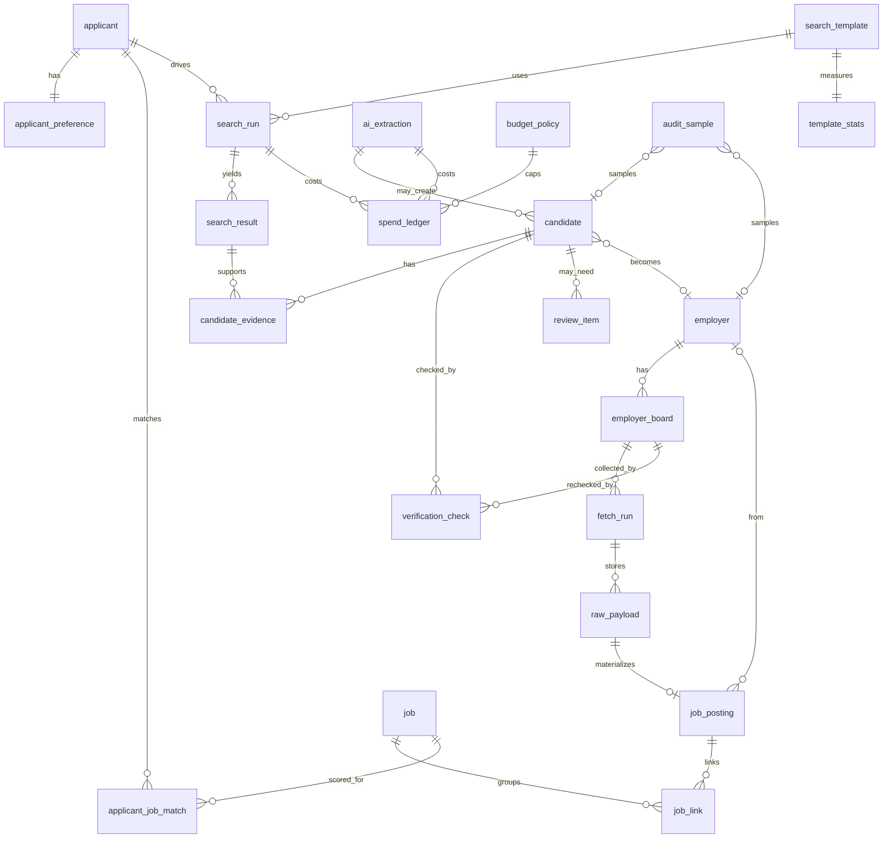

# Step 1: Milestone 1 data model

**Status:** design for approval. No migrations or application code in this step.

**Sources:** MVP.md section 9 (candidate queue), section 15 (entities), D3, D4, D12, D13, D15, D20, D22. Build order Stage A item 1.

**Goal:** the smallest PostgreSQL schema that can run discovery → verification → directory → collection → matching for Milestone 1, with unique keys that survive crashes and a claim pattern a worker can use safely.

---

## Recommendation

Use **one table per Milestone 1 entity from section 15**, with these concrete choices:

1. **Queue lives on domain rows**, not in Redis and not in a generic `work_item` table. `candidate` and `search_run` each carry `state`, `attempt_count`, `next_attempt_at`, and `claimed_at`. Workers claim with `SELECT … FOR UPDATE SKIP LOCKED`.
2. **Evidence is relational.** Keep `candidate_evidence`, `search_result`, `verification_check`, and `raw_payload` as tables. Put **JSONB only** on payload bodies, provenance maps, and small structured blobs where the MVP already treats the value as a document.
3. **Milestone 2 tables stay out.** No `applicant_profile`, skills, certifications, CV, ESCO, or `job_summary`. No password columns on `applicant` until accounts land.
4. **Primary keys are UUIDs.** Natural unique keys are partial or composite unique indexes named below. Enum-like fields are `text` plus `CHECK` constraints (not PostgreSQL `ENUM` types), so Alembic stays simple.

Approve this design before Step 1 Build writes Alembic models.

---

## Scope

### In Milestone 1

| Group | Tables |
|---|---|
| Applicants | `applicant`, `applicant_preference` |
| Spending | `budget_policy`, `spend_ledger` |
| Search | `search_template`, `search_run`, `search_result`, `template_stats` |
| Discovery | `candidate`, `candidate_evidence`, `ai_extraction`, `verification_check`, `review_item` |
| Directory | `employer`, `employer_board` |
| Collection | `fetch_run`, `raw_payload`, `job_posting`, `job`, `job_link` |
| Matching and audit | `applicant_job_match`, `audit_sample` |

### Deferred to Milestone 2

`applicant_profile`, `applicant_skill`, `applicant_certification`, `cv_file`, `skill`, `job_skill`, `job_summary`, and auth fields on `applicant` (`password_hash`, sessions).

`applicant_job_match` in Milestone 1 stores role, location, and salary status only. Skill and licence columns arrive later.

---

## Entity-relationship diagram



---

## Tables and key fields

Conventions for every table unless noted:

- `id uuid PRIMARY KEY` (generated in app or `gen_random_uuid()`)
- `created_at timestamptz NOT NULL DEFAULT now()`
- `updated_at timestamptz NOT NULL DEFAULT now()` where rows are mutated after insert

### Applicants

**`applicant`**

| Column | Type | Notes |
|---|---|---|
| `id` | uuid PK | |
| `email` | citext | Unique. Admin identity in Milestone 1; login comes in Milestone 2 |
| `display_name` | text | Optional |
| `is_active` | boolean | Default true |
| `created_at` | timestamptz | |

No password hash here. D20 keeps Milestone 1 admin-created.

**`applicant_preference`**

| Column | Type | Notes |
|---|---|---|
| `id` | uuid PK | |
| `applicant_id` | uuid FK → applicant | Unique (one preference row per applicant) |
| `target_roles` | text[] | Non-empty |
| `locations` | text[] | Non-empty |
| `sector` | text | Milestone 1 default `tech` |
| `salary_amount` | numeric | Nullable. Matching only (D3, D4) |
| `salary_currency` | text | Nullable when amount is null |
| `salary_period` | text | e.g. `year`, `hour`; null when amount is null |
| `updated_at` | timestamptz | |

Salary columns live only on this table so search, AI, and budget code can avoid selecting them (T1).

### Spending

**`budget_policy`**

| Column | Type | Notes |
|---|---|---|
| `id` | uuid PK | |
| `provider` | text | e.g. search API name, `ai`, or `*` |
| `period` | text | `month` for MVP caps |
| `money_cap` | numeric | Nullable until B1 is set; gate refuses paid calls when null or zero |
| `request_cap` | integer | Nullable |
| `currency` | text | Default `GBP` or `USD` per provider |
| `effective_from` | timestamptz | |
| `effective_to` | timestamptz | Nullable = open-ended |

Unique: `(provider, period, effective_from)`.

**`spend_ledger`**

| Column | Type | Notes |
|---|---|---|
| `id` | uuid PK | |
| `provider` | text | |
| `kind` | text | `search`, `ai_extraction`, `ai_summary` (summary unused until M2) |
| `related_run_id` | uuid | Nullable FK soft-ref to `search_run` or later types |
| `related_item_id` | uuid | Nullable (candidate, extraction, etc.) |
| `estimated_cost` | numeric | |
| `actual_cost` | numeric | Nullable until settled |
| `units` | numeric | Tokens or requests |
| `unit_label` | text | `request`, `token` |
| `occurred_at` | timestamptz | |

Index: `(provider, occurred_at)` for cap checks.

### Search

**`search_template`**

| Column | Type | Notes |
|---|---|---|
| `id` | text PK | Natural ID: `CF1`, `CF1b`, `CF2`, `CF3`, `BD1`, `BD2` |
| `search_type` | text | company-first / board-direct family |
| `provider` | text | |
| `pattern` | text | Human-readable pattern description |
| `status` | text | `unproven` / `active` / `retired` |
| `created_at` | timestamptz | |

**`search_run`** (also a queue row)

| Column | Type | Notes |
|---|---|---|
| `id` | uuid PK | |
| `template_id` | text FK → search_template | |
| `applicant_id` | uuid FK → applicant | Preference owner for this run |
| `query` | text | Exact query sent (never includes salary) |
| `provider` | text | |
| `status` | text | `planned` → `running` → `succeeded` / `failed` / `inconclusive` |
| `attempt_count` | int | Default 0 |
| `next_attempt_at` | timestamptz | Nullable when terminal |
| `claimed_at` | timestamptz | Set while `running` |
| `result_count` | int | Nullable |
| `cost_amount` | numeric | Nullable |
| `last_error` | text | Nullable |
| `started_at` / `finished_at` | timestamptz | Nullable |
| `created_at` | timestamptz | |

Indexes for claiming: see [Queue claim](#queue-claim).

**`search_result`**

| Column | Type | Notes |
|---|---|---|
| `id` | uuid PK | |
| `search_run_id` | uuid FK → search_run | ON DELETE CASCADE |
| `rank` | int | |
| `url` | text | |
| `title` | text | |
| `snippet` | text | Short; retention subject to V1 / terms (D15) |
| `created_at` | timestamptz | |

Unique: `(search_run_id, rank)`. Index on `url` for grounding lookups.

**`template_stats`**

| Column | Type | Notes |
|---|---|---|
| `template_id` | text PK FK → search_template | |
| `run_count` | int | |
| `total_cost` | numeric | |
| `new_candidates` | int | |
| `new_verified_boards` | int | |
| `relevant_jobs` | int | |
| `freshness_share` | numeric | 0–1 |
| `updated_at` | timestamptz | |

Stats count only after 5 runs for ranking (D11). The table still records every run's aggregates from the first run.

### Discovery

**`candidate`** (primary queue row)

| Column | Type | Notes |
|---|---|---|
| `id` | uuid PK | |
| `company_name` | text | As extracted |
| `cleaned_name` | text | Lowercase, strip Ltd/Limited/PLC/punctuation |
| `domain_candidates` | text[] | Registrable domains from evidence |
| `primary_domain` | text | Nullable until verified |
| `board_system` | text | Nullable (`greenhouse`, `lever`, …) |
| `board_instance` | text | Nullable (`global`, `eu`, …) |
| `board_id` | text | Nullable |
| `state` | text | Section 9 machine |
| `attempt_count` | int | Verification attempts; max 3 then `needs_review` (D12) |
| `next_attempt_at` | timestamptz | Claim filter |
| `claimed_at` | timestamptz | Crash recovery for `verifying` |
| `last_error` | text | Nullable |
| `extracted_by` | text | `code` or `ai` |
| `ai_extraction_id` | uuid FK → ai_extraction | Nullable |
| `merged_into_candidate_id` | uuid FK → candidate | Set when state is `duplicate` |
| `employer_id` | uuid FK → employer | Set on register |
| `revisit_at` | timestamptz | For `unsupported` → requeue (D13) |
| `created_at` / `updated_at` | timestamptz | |

Allowed `state` values: `new`, `duplicate`, `queued`, `verifying`, `retry_wait`, `needs_review`, `verified`, `registered`, `unsupported`, `rejected`.

**`candidate_evidence`**

| Column | Type | Notes |
|---|---|---|
| `id` | uuid PK | |
| `candidate_id` | uuid FK → candidate | |
| `search_result_id` | uuid FK → search_result | Nullable if evidence is not from search |
| `quoted_text` | text | Max 200 chars at write time (MVP extraction format) |
| `source_url` | text | |
| `created_at` | timestamptz | |

Index: `(candidate_id)`. When a new extract is marked `duplicate`, its evidence rows are **moved or copied** onto the surviving candidate (section 9).

**`ai_extraction`**

| Column | Type | Notes |
|---|---|---|
| `id` | uuid PK | |
| `input_hash` | text | Unique with `prompt_version` for idempotent retries |
| `model` | text | |
| `prompt_version` | text | |
| `output` | jsonb | Parsed structured output |
| `grounded_count` | int | |
| `ungrounded_count` | int | |
| `cost_amount` | numeric | |
| `created_at` | timestamptz | |

Unique: `(input_hash, prompt_version)`.

**`verification_check`**

| Column | Type | Notes |
|---|---|---|
| `id` | uuid PK | |
| `candidate_id` | uuid FK | Nullable if checking a registered board |
| `employer_board_id` | uuid FK | Nullable |
| `check_type` | text | e.g. `official_domain`, `ownership_link`, `board_api` |
| `outcome` | text | `pass`, `fail`, `inconclusive`, `error` |
| `evidence_url` | text | Nullable |
| `evidence_snippet` | text | Nullable; not full page (D15) |
| `http_status` | int | Nullable |
| `checked_at` | timestamptz | |

Check: at least one of `candidate_id` or `employer_board_id` is set.

**`review_item`**

| Column | Type | Notes |
|---|---|---|
| `id` | uuid PK | |
| `candidate_id` | uuid FK → candidate | |
| `reason` | text | |
| `priority` | int | Higher first |
| `decision` | text | Nullable until decided: `verified`, `rejected`, `unsupported` |
| `reviewer` | text | Nullable |
| `decided_at` | timestamptz | Nullable |
| `notes` | text | Nullable |
| `created_at` | timestamptz | |

Unique open item: partial unique on `candidate_id` where `decided_at IS NULL`.

### Directory

**`employer`**

| Column | Type | Notes |
|---|---|---|
| `id` | uuid PK | |
| `name` | text | |
| `cleaned_name` | text | Indexed for grouping, **not** unique alone |
| `official_domain` | text | **UNIQUE** (registrable domain) |
| `sector` | text | Default `tech` |
| `careers_system` | text | Including unsupported systems |
| `revisit_at` | timestamptz | Unsupported revisit (D13) |
| `created_at` / `updated_at` | timestamptz | |

**`employer_board`**

| Column | Type | Notes |
|---|---|---|
| `id` | uuid PK | |
| `employer_id` | uuid FK → employer | |
| `system` | text | `greenhouse`, `lever` |
| `instance` | text | `global`, `eu`, … |
| `board_id` | text | |
| `evidence_level` | text | `strong` / `medium` / `weak` |
| `status` | text | `verified` / `needs_reverify` / `retired` |
| `verified_at` | timestamptz | |
| `last_checked_at` | timestamptz | |
| `next_reverify_at` | timestamptz | D13: +30 days |
| `consecutive_failures` | int | Default 0 |
| `last_job_count` | int | Nullable |
| `created_at` / `updated_at` | timestamptz | |

Unique: `(system, instance, board_id)`.

### Collection and jobs

**`fetch_run`**

| Column | Type | Notes |
|---|---|---|
| `id` | uuid PK | |
| `source` | text | `greenhouse`, `lever`, `reed`, `adzuna` |
| `employer_board_id` | uuid FK | Nullable for non-board searches |
| `search_run_id` | uuid FK | Nullable for Reed/Adzuna collection from CF runs |
| `outcome` | text | `complete` / `partial` / `failed` / `not_found` / `empty` |
| `http_status` | int | Nullable |
| `jobs_returned` | int | |
| `request_count` | int | |
| `started_at` / `finished_at` | timestamptz | |

**`raw_payload`**

| Column | Type | Notes |
|---|---|---|
| `id` | uuid PK | |
| `fetch_run_id` | uuid FK → fetch_run | |
| `source` | text | |
| `source_job_id` | text | Nullable for board-level payloads |
| `payload` | jsonb | Raw API body (D15, D22) |
| `payload_hash` | text | sha256 of canonical bytes |
| `fetched_at` | timestamptz | |

Index: `(source, source_job_id, fetched_at DESC)`. Unique optional later on `(fetch_run_id, source_job_id)` when per-job rows exist.

**`job_posting`**

| Column | Type | Notes |
|---|---|---|
| `id` | uuid PK | |
| `source` | text | |
| `source_job_id` | text | |
| `employer_id` | uuid FK | Nullable for agencies |
| `employer_board_id` | uuid FK | Nullable |
| `raw_payload_id` | uuid FK → raw_payload | Provenance |
| `title` | text | |
| `company_name` | text | |
| `employer_type` | text | `direct` / `agency` |
| `location_city` | text | Nullable |
| `location_country` | text | Nullable |
| `remote_type` | text | Nullable |
| `salary_min` / `salary_max` | numeric | Nullable |
| `salary_currency` | text | Nullable |
| `salary_period` | text | Nullable |
| `salary_known` | boolean | False ⇒ unknown (D4); never store missing as zero |
| `hours` / `contract_type` | text | Nullable |
| `description` | text | Full text when terms allow |
| `apply_url` | text | |
| `posted_at` / `closes_at` | timestamptz | Nullable |
| `first_seen_at` / `last_seen_at` | timestamptz | |
| `last_seen_complete_fetch_at` | timestamptz | Nullable; closing rule |
| `created_at` / `updated_at` | timestamptz | |

Unique: `(source, source_job_id)`.

**`job`** (master record)

| Column | Type | Notes |
|---|---|---|
| `id` | uuid PK | |
| `employer_id` | uuid FK | Nullable |
| `title` | text | |
| `company_name` | text | |
| `location_city` / `location_country` / `remote_type` | text | |
| `salary_*` + `salary_known` | same shape as posting | |
| `description` | text | |
| `apply_url` | text | |
| `sector` | text | |
| `freshness` | text | `open` / `closed` / `unknown` |
| `field_provenance` | jsonb | Map field → source posting id |
| `closure_evidence` | jsonb | Nullable; fetch_run ids that justified close (T23) |
| `quality_results` | jsonb | Completeness / real / recent flags from Stage C |
| `first_seen_at` / `last_seen_at` | timestamptz | |
| `created_at` / `updated_at` | timestamptz | |

**`job_link`**

| Column | Type | Notes |
|---|---|---|
| `id` | uuid PK | |
| `job_posting_id` | uuid FK → job_posting | |
| `job_id` | uuid FK → job | |
| `method` | text | `exact_job_id` / `strong_match` / `reviewer` |
| `confidence` | numeric | |
| `reason` | text | |
| `created_at` | timestamptz | |

Unique: `(job_posting_id, job_id)`. Prefer one master link per posting in Milestone 1 (unique on `job_posting_id` alone is acceptable if postings never split).

### Matching and audit

**`applicant_job_match`**

| Column | Type | Notes |
|---|---|---|
| `id` | uuid PK | |
| `applicant_id` | uuid FK → applicant | |
| `job_id` | uuid FK → job | |
| `score` | numeric | |
| `reasons` | jsonb | Structured reasons for UI and T27 |
| `role_match` | boolean | |
| `location_fit` | boolean | |
| `salary_status` | text | `meets` / `below` / `unknown` |
| `created_at` / `updated_at` | timestamptz | |

Unique: `(applicant_id, job_id)`. No skill or licence columns yet.

**`audit_sample`**

| Column | Type | Notes |
|---|---|---|
| `id` | uuid PK | |
| `candidate_id` | uuid FK | Nullable |
| `employer_id` | uuid FK | Nullable |
| `system_result` | text | |
| `auditor_result` | text | Nullable until audited |
| `is_correct` | boolean | Nullable |
| `is_useful` | boolean | Nullable (audit part 2) |
| `notes` | text | Nullable |
| `created_at` | timestamptz | |

---

## Unique keys and indexes

These are the keys Step 1 Build must prove with tests (PROMPTS.md Step 1 Build): same board, same official domain, and same source job ID cannot be stored twice.

| Constraint | Definition |
|---|---|
| `employer.official_domain` | `UNIQUE` |
| `employer_board (system, instance, board_id)` | `UNIQUE` |
| `job_posting (source, source_job_id)` | `UNIQUE` |
| `applicant.email` | `UNIQUE` |
| `applicant_preference.applicant_id` | `UNIQUE` |
| `search_template.id` | Primary key (natural) |
| `ai_extraction (input_hash, prompt_version)` | `UNIQUE` |
| `applicant_job_match (applicant_id, job_id)` | `UNIQUE` |
| `search_result (search_run_id, rank)` | `UNIQUE` |
| Open `review_item` per candidate | Partial unique where undecided |

**Candidate dedupe indexes (not full unique on all rows):**

1. **Board key among live candidates.** Partial unique on `(board_system, board_instance, board_id)` where those columns are not null and `state` not in (`duplicate`, `rejected`). Prevents two active queue rows for the same board.
2. **Primary domain among live candidates.** Partial unique on `primary_domain` where not null and `state` not in (`duplicate`, `rejected`). Aligns with "same official domain → merge".
3. **Name grouping.** Non-unique index on `cleaned_name` for co-checking. Never unique; never merge across domains on name alone (section 9).

**Queue claim indexes:**

- `candidate (state, next_attempt_at)` where `state IN ('queued', 'retry_wait')`
- `search_run (status, next_attempt_at)` where `status IN ('planned', 'failed')` awaiting retry
- `employer_board (status, next_reverify_at)` for the 30-day re-verify pass

**Lookup indexes:** `spend_ledger (provider, occurred_at)`, `job (freshness)`, `job_posting (employer_board_id)`, `candidate_evidence (candidate_id)`.

---

## Queue claim

Section 9 stores the queue as **database rows with state + next attempt time**. D22 chose PostgreSQL so workers can use row locking. Milestone 1 still runs **one worker process**, but the claim shape must stay correct if a second worker appears later.

### States that are claimable

| Table | Claimable states | After claim | Terminal / wait |
|---|---|---|---|
| `candidate` | `queued`, `retry_wait` (and `unsupported` when `revisit_at <= now()`, which first moves to `queued`) | `verifying`, set `claimed_at = now()` | `duplicate`, `needs_review`, `verified`, `registered`, `rejected`; `retry_wait` sets `next_attempt_at` |
| `search_run` | `planned`, or `failed` with attempts remaining and `next_attempt_at <= now()` | `running` | `succeeded`, `failed` (exhausted), `inconclusive` |

Retry schedules (D12): verification 1h / 6h / 24h; search 1 / 5 / 30 minutes.

### Claim SQL (candidate)

Run inside a short transaction:

```sql
SELECT id
FROM candidate
WHERE state IN ('queued', 'retry_wait')
  AND next_attempt_at <= now()
ORDER BY next_attempt_at ASC
FOR UPDATE SKIP LOCKED
LIMIT 1;

UPDATE candidate
SET state = 'verifying',
    claimed_at = now(),
    attempt_count = attempt_count + 1,
    updated_at = now()
WHERE id = :id;
```

Commit before doing network I/O. On success, transition to `verified` / `needs_review` / `unsupported` and clear `claimed_at`. On request failure, set `retry_wait`, clear `claimed_at`, bump `next_attempt_at`, and if `attempt_count >= 3` set `needs_review` instead (D8, D12).

### Crash recovery

If the process dies while `state = 'verifying'` (or `search_run.status = 'running'`), the row would stick without a reclaim rule.

**Rule:** a sweeper (same worker loop is enough) resets rows where `claimed_at < now() - interval '15 minutes'` back to `retry_wait` or `planned` with `next_attempt_at = now()`, without incrementing attempt count again. Idempotent unique keys (section 13) keep re-runs from duplicating employers, boards, or postings.

### Why not a separate queue table

A generic `work_item(kind, payload, state, next_attempt_at)` duplicates the candidate and search_run state machines and forces every feature to serialize and deserialize domain fields. Section 9 already names the states on those entities. Keeping queue columns on the domain rows is the smaller model (Laziness Protocol) and matches the domain state machine (Model the Domain).

---

## Alternatives compared

### 1. Where queue state lives

| Option | Pros | Cons | Verdict |
|---|---|---|---|
| **A. Columns on `candidate` / `search_run`** | Matches section 9; one row is the work unit; SKIP LOCKED is natural | Claim indexes must be maintained per table | **Choose** |
| B. Generic `work_item` table | One claim path | Duplicates state; payload JSON; harder joins for review and metrics | Reject for MVP |
| C. Redis / Celery / RQ | Familiar worker tooling | Extra system; D22 already picked Postgres queue; crash + budget coupling worse | Reject |

### 2. Evidence storage

| Option | Pros | Cons | Verdict |
|---|---|---|---|
| **A. Tables: `candidate_evidence`, `search_result`, `verification_check`** | Merge-on-duplicate appends rows; grounding queries by URL; audit trail | More tables | **Choose** |
| B. JSONB array on `candidate` | Fewer tables | Merge and grounding become app-side array edits; weak indexes | Reject |
| C. Hybrid (table for search results, JSONB for the rest) | Slightly fewer FKs | Two styles for the same idea | Reject |

Raw job API bodies stay in **`raw_payload.payload` JSONB** (D15, D22). That is document data, not relational evidence links.

### 3. Applicant preferences

| Option | Pros | Cons | Verdict |
|---|---|---|---|
| **A. Separate `applicant_preference`** | Salary isolated for T1; matches section 15; M2 can add profile tables beside it | Extra join | **Choose** |
| B. Columns on `applicant` | One table | Salary easier to leak into shared DTOs; messier when M2 profile arrives | Reject |
| C. Single JSONB `preferences` | Flexible | Weak typing; harder CHECK constraints | Reject |

### 4. Jobs: posting vs master

| Option | Pros | Cons | Verdict |
|---|---|---|---|
| **A. `job_posting` + `job` + `job_link`** | Conservative duplicate linking (Stage 9); provenance; T26 | Three tables | **Choose** |
| B. Only `job_posting` (no master) | Simpler | Cross-source duplicates and listings become messy | Reject |
| C. Only `job` with embedded sources JSON | Fewer rows | Updates and unique source IDs fight the document | Reject |

### 5. Enums

| Option | Pros | Cons | Verdict |
|---|---|---|---|
| **A. `text` + `CHECK`** | Easy Alembic; app Enum mirrors DB | Constraint updates need migrations | **Choose** |
| B. PostgreSQL `ENUM` | Strict | Painful to alter in Alembic | Reject for MVP |
| C. Unconstrained text | Fast to start | Illegal states in DB | Reject |

### 6. Primary keys

| Option | Pros | Cons | Verdict |
|---|---|---|---|
| **A. UUID** | Safe merge across envs; no sequence coupling | Larger indexes | **Choose** |
| B. Bigserial | Smaller | Fine too; no strong MVP need | Acceptable alternative if you prefer |

---

## Relationship summary

- One shared **employer directory** (D1). Candidates register into `employer` + `employer_board`.
- Discovery is preference-driven via `search_run.applicant_id`, but boards and jobs are shared.
- Collection writes `fetch_run` → `raw_payload` → `job_posting`, then linking creates or updates `job`.
- Matching runs after collection: `applicant_job_match` rows per applicant × job (D2).
- Spending never reads `applicant_preference` salary columns (D3).

---

## Out of scope for this Decide

- Alembic migrations and SQLAlchemy models (Step 1 Build, after approval)
- Fetch gateway and budget gate implementation (Step 2)
- Worker loop code (later discovery steps)
- Milestone 2 auth and profile schema

---

## Proposed MVP.md section 20 decision

**New row needed.** Section 15 lists entities but leaves the exact schema to the build step. D22 covers the stack, not the Milestone 1 table choices. After approval, add:

| ID | Decision |
|---|---|
| D27 | Milestone 1 schema follows `docs/step1-data-model.md`: domain-row queues on `candidate` and `search_run` with `state`/`status` + `next_attempt_at` + `claimed_at`, claimed via `FOR UPDATE SKIP LOCKED`; unique keys on `employer.official_domain`, `employer_board (system, instance, board_id)`, and `job_posting (source, source_job_id)`; relational evidence tables plus JSONB only for raw payloads and small structured maps; Milestone 2 entities omitted. |

If you want a shorter D-row, keep the pointer to this doc as the source of truth and avoid restating every constraint in the table.

---

## Approval checklist

Confirm or adjust:

1. Domain-row queue + SKIP LOCKED (not Redis, not `work_item`)
2. Relational evidence tables; JSONB for `raw_payload.payload`, `field_provenance`, `quality_results`, `reasons`
3. Milestone 2 tables omitted; no password columns yet
4. Partial unique indexes on live candidate board key and primary domain
5. 15-minute `claimed_at` reclaim for crashed `verifying` / `running` rows
6. Add D27 as above after approval

Stop here until you approve. Step 1 Build then implements migrations and unique-key tests only.
)
